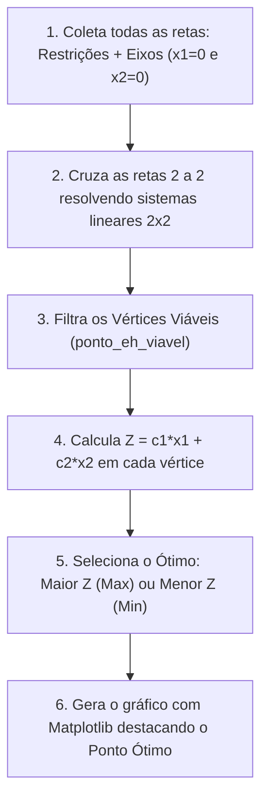
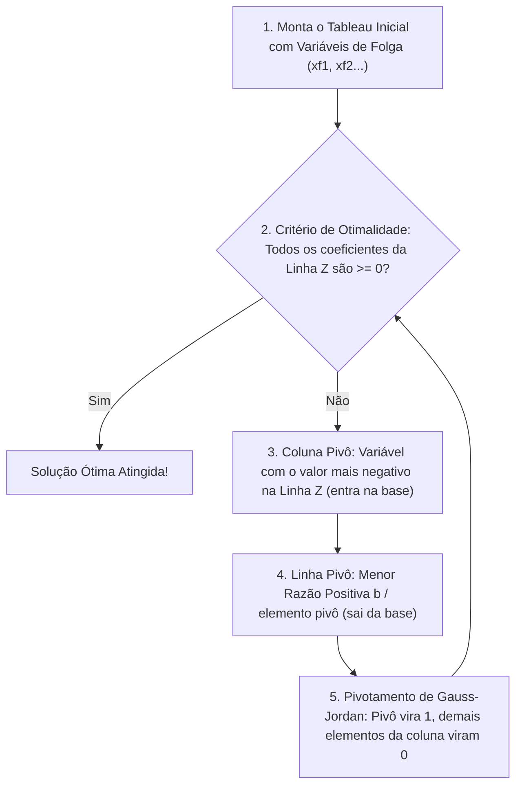

# Programação Linear — Documentação e Guia Didático do Projeto

Este projeto é uma aplicação interativa desenvolvida em Python e **Streamlit** para resolução de problemas de **Programação Linear (PL)** através de dois métodos fundamentais: o **Método Gráfico** e o **Método Simplex**.

O objetivo deste documento é explicar detalhadamente, de forma didática e acessível para quem está aprendendo a programar, como cada arquivo e cada função do projeto foram construídos, conectando os conceitos matemáticos da sala de aula com a implementação em código.

---

## 📁 1. Estrutura de Arquivos e Visão Geral

O projeto adota uma arquitetura modular, separando a **interface com o usuário**, as **funções auxiliares de suporte** e os **métodos matemáticos de cálculo**:

```text
Linear-Programming-program/
│
├── PLANO.md                  ← Este documento com a explicação didática completa
├── README.md                 ← Apresentação do projeto e instruções rápidas de execução
├── requirements.txt          ← Lista de bibliotecas necessárias (numpy, pandas, matplotlib, streamlit)
├── main.py                   ← Interface visual com Streamlit (entradas, botões e exibição)
│
├── metodos/
│   ├── __init__.py           ← Arquivo que transforma a pasta em um pacote importável
│   ├── grafico.py            ← Lógica do Método Gráfico (2 variáveis) e desenho no Matplotlib
│   ├── simplex.py            ← Lógica do Método Simplex (Tableau e pivotamento de Gauss-Jordan)
│   └── bigm.py               ← Estrutura para o Método Big-M (extensão futura)
│
└── utils/
    ├── __init__.py           ← Arquivo que transforma a pasta em um pacote importável
    └── entrada.py            ← Funções de extração e validação matemática de dados
```

### O que é o `__init__.py`?
É um arquivo vazio colocado dentro de pastas como `metodos/` e `utils/`. Ele sinaliza para o Python que aquela pasta deve ser tratada como um **módulo/pacote**. Graças a ele, podemos fazer comandos como `from metodos.simplex import resolver_simplex` em qualquer outro arquivo.

---

## 🛠️ 2. Validação e Tratamento de Dados (`utils/entrada.py`)

Antes de qualquer algoritmo rodar, os dados que o usuário digita nos campos da interface precisam ser organizados e validados para garantir que as regras da Programação Linear sejam respeitadas.

### 2.1. Função `extrair_dados_formulario`
```python
extrair_dados_formulario(num_variaveis, num_restricoes, session_state)
```
- **Objetivo:** O Streamlit armazena o que o usuário digita em um dicionário interno chamado `st.session_state`. Esta função lê essas variáveis (`fo_0`, `fo_1`, `restricao_0_0`, `b_0`, etc.) e as converte em estruturas limpas do **NumPy**:
  - `c`: Vetor com os coeficientes da Função Objetivo (ex: $[3, 5]$).
  - `constante`: Número fixo somado na função objetivo (se houver).
  - `A`: Matriz com os coeficientes tecnológicos do lado esquerdo das restrições.
  - `tipos`: Lista com os sinais de cada restrição (`"<="`, `">="`, `"="`).
  - `b`: Vetor com os limites do lado direito (*Right-Hand Side* - RHS).

### 2.2. Função `validar_dados`
```python
validar_dados(metodo, num_variaveis, c, A, tipos, b)
```
- **Objetivo:** Evitar que dados inválidos quebrem o algoritmo ou violem as premissas matemáticas.
- **Regras verificadas:**
  1. **Método Gráfico:** Só aceita exatamente **2 variáveis** ($x_1$ e $x_2$).
  2. **Simplex Padrão:** Só aceita restrições do tipo **$\le$**. Se houver restrições $\ge$ ou $=$, o usuário é avisado para utilizar o método Big-M.
  3. **Linhas nulas:** Verifica se alguma linha de restrição em $A$ está inteiramente zerada (ex: $0x_1 + 0x_2 \le 10$).
  4. **Lado direito não-negativo:** No Simplex padrão, $b_i$ deve ser $\ge 0$.
- **Retorno:** Devolve uma tupla com dois valores: `(True/False, "Mensagem explicativa")`.

---

## 📈 3. Método Gráfico (`metodos/grafico.py`)

### 3.1. A Intuição Matemática
O Método Gráfico é puramente geométrico e se baseia no **Teorema Fundamental da Programação Linear**:
> *"Se um problema de Programação Linear tem solução ótima finita, ela obrigatoriamente se encontra em pelo menos um dos vértices (cantos) da região viável."*

Como temos 2 variáveis ($x_1$ e $x_2$), a região viável é uma área poligonal no 1º quadrante do plano cartesiano ($x_1 \ge 0$ e $x_2 \ge 0$). Os vértices dessa área nascem do **cruzamento de duas retas**.



---

### 3.2. Funções Internas e Lógica

#### A) `ponto_eh_viavel(ponto, A, tipos, b)`
- **O que faz:** Recebe as coordenadas de um ponto $[x_1, x_2]$ e testa se ele é viável.
- **Critérios:**
  1. **Não-negatividade:** $x_1 \ge 0$ e $x_2 \ge 0$.
  2. **Satisfação de todas as restrições:** Para cada restrição $i$, calcula $a_{i1} x_1 + a_{i2} x_2$ e confere se atende ao operador (`<=`, `>=`, `=`) em relação a $b_i$.
  3. Se passar em todos os testes, retorna `True`; caso contrário, `False`.

#### B) `encontrar_vertices(A, tipos, b)`
- **O que faz:** Encontra todos os cantos da região viável.
- **Como funciona:**
  1. Cria uma lista com todas as equações de reta: as restrições fornecidas mais os eixos cartesianos ($1x_1 + 0x_2 = 0$ e $0x_1 + 1x_2 = 0$).
  2. Faz uma combinação de todas as retas, **duas a duas** (usando dois loops `for`).
  3. Para cada par, monta o sistema linear $2 \times 2$:
     $$\begin{pmatrix} a_{11} & a_{12} \\ a_{21} & a_{22} \end{pmatrix} \begin{pmatrix} x_1 \\ x_2 \end{pmatrix} = \begin{pmatrix} b_1 \\ b_2 \end{pmatrix}$$
  4. Se o determinante for diferente de zero (`np.linalg.det(M) != 0`), as retas se cruzam e calculamos a interseção com `np.linalg.solve(M, rhs)`.
  5. Se o ponto for viável (`ponto_eh_viavel`), adicionamos à lista de vértices (evitando duplicatas).

#### C) `resolver_grafico(c, constante, A, tipos, b, tipo_otimizacao)`
- **O que faz:**
  1. Obtém os vértices viáveis com `encontrar_vertices`.
  2. Para cada vértice $v = (x_1, x_2)$, calcula $Z = c_1 x_1 + c_2 x_2 + \text{constante}$.
  3. **Tratamento de Maximizar vs Minimizar:**
     - Se `tipo_otimizacao == "Maximizar"`: usa `np.argmax(valores_z)` para escolher o vértice com **maior Z**.
     - Se `tipo_otimizacao == "Minimizar"`: usa `np.argmin(valores_z)` para escolher o vértice com **menor Z**.
  4. Desenha as retas no gráfico com `matplotlib.pyplot`, marca os vértices viáveis em azul e destaca o **Ponto Ótimo** com uma estrela vermelha.
  5. Retorna `(ponto_otimo, z_otimo, figura)`.

---

## 📊 4. Método Simplex (`metodos/simplex.py`)

### 4.1. A Intuição Algébrica
Quando o problema tem 3 ou mais variáveis, não podemos mais desenhar um gráfico. O **Simplex** resolve esse problema de forma puramente algébrica:
1. Começa em uma **solução básica inicial** (na origem, onde as variáveis originais valem $0$ e as folgas absorvem toda a capacidade).
2. Transforma o sistema em uma tabela matricial chamada **Tableau**.
3. Realiza **iterações (pivotamentos)**: a cada passo, ele troca uma variável da base por uma não-básica, "caminhando" para um vértice vizinho que melhore o valor de $Z$.
4. Para quando nenhum vértice vizinho for melhor (solução ótima atingida).



---

### 4.2. Estrutura do Tableau Simplex

Para um problema com $n$ variáveis de decisão e $m$ restrições do tipo $\le$, adicionamos **$m$ variáveis de folga** ($xf_1, xf_2, \dots, xf_m$):

| Base | $x_1$ | $x_2$ | $\dots$ | $x_n$ | $xf_1$ | $xf_2$ | $\dots$ | $xf_m$ | Lado Direito ($b$) |
| :---: | :---: | :---: | :---: | :---: | :---: | :---: | :---: | :---: | :---: |
| $xf_1$ | $a_{11}$ | $a_{12}$ | $\dots$ | $a_{1n}$ | 1 | 0 | $\dots$ | 0 | $b_1$ |
| $xf_2$ | $a_{21}$ | $a_{22}$ | $\dots$ | $a_{2n}$ | 0 | 1 | $\dots$ | 0 | $b_2$ |
| **Linha Z** | **$-c_1$** | **$-c_2$** | $\dots$ | **$-c_n$** | **0** | **0** | $\dots$ | **0** | **$-\text{constante}$** |

> **Por que os custos $c$ entram com sinal negativo na Linha Z?**  
> A equação da função objetivo é $Z = c_1 x_1 + c_2 x_2$.  
> Passando todos os termos para o lado esquerdo na forma canônica: $Z - c_1 x_1 - c_2 x_2 = 0$. Por isso os coeficientes entram com sinal invertido ($-c$).

---

### 4.3. Como Funciona Maximizar vs Minimizar no Simplex?

Na Programação Linear, minimizar uma função é equivalente a maximizar o seu negativo:
$$\min Z(x) \iff \max \big(-Z(x)\big)$$

No nosso código:
1. Se o usuário escolher **Minimizar**, invertemos o sinal dos coeficientes no início:
   ```python
   if tipo_otimizacao == "Minimizar":
       coeficientes_ajustados = -coeficientes_objetivo
   ```
2. O algoritmo roda o loop padrão de maximização exatamente da mesma forma.
3. No final, desfazemos a inversão de sinal no valor final de $Z$:
   ```python
   if tipo_otimizacao == "Minimizar":
       valor_z_otimo = -valor_z_otimo
   ```

---

### 4.4. Passo a Passo do Algoritmo (`resolver_simplex`)

1. **Montagem Inicial (`criar_tabela_inicial`):**
   - Cria a matriz de restrições com as folgas acopladas usando `np.hstack([A, folgas, b])`.
   - Adiciona a linha de $Z$ na última posição usando `np.vstack`.
   - Define a base inicial com as variáveis de folga.

2. **Loop de Iteração:**
   - **Passo A — Critério de Parada:** Olha a última linha (linha de $Z$). Se todos os números forem $\ge 0$, o algoritmo para, pois nenhuma variável consegue mais aumentar $Z$.
   - **Passo B — Coluna Pivô (Entra na base):** Escolhe a coluna que tem o valor mais negativo na linha de $Z$ (`np.argmin(coeficientes_linha_objetivo)`).
   - **Passo C — Linha Pivô (Sai da base - Teste da Razão Mínima):**  
     Para cada restrição $i$, se o elemento da coluna pivô for estritamente positivo ($a_{i, \text{pivo}} > 0$), calcula:
     $$\text{razão} = \frac{b_i}{a_{i, \text{pivo}}}$$
     A linha com a menor razão é escolhida. *(Se nenhum elemento for $> 0$, o problema é ilimitado).*
   - **Passo D — Pivotamento (Eliminação de Gauss-Jordan):**
     1. Divide a linha pivô inteira pelo valor do elemento pivô para que ele se torne $1$.
     2. Zera todos os outros elementos daquela coluna (nas outras restrições e na linha de $Z$) subtraindo múltiplos da linha pivô.
   - **Passo E — Histórico:** Salva uma cópia da tabela (`tabela.copy()`) na lista `historico_tabelas` para exibição na interface.

3. **Extração da Resposta:**
   - Variáveis que não terminaram na base têm valor $0.0$ (não-básicas).
   - Variáveis que terminaram na base recebem o valor da coluna $b$ na sua respectiva linha.
   - O valor ótimo de $Z$ é extraído da última linha e última coluna.

---

## 🖥️ 5. Interface com o Usuário (`main.py`)

O arquivo [`main.py`](main.py:1) utiliza o **Streamlit** para construir uma aplicação web interativa:

- **Barra Lateral (`st.sidebar`):** Permite ao usuário escolher o método desejado: `"Simplex"`, `"Método gráfico"` ou `"Big M"`.
- **Formulários Dinâmicos:**
  - Gera automaticamente os campos numéricos para as variáveis ($x_1, x_2, \dots, x_n$) e restrições conforme a quantidade informada.
  - No Método Gráfico, fixa automaticamente a quantidade em 2 variáveis.
- **Botão Resolver:**
  - Lê e valida os dados com `extrair_dados_formulario` e `validar_dados`.
  - Exibe mensagens claras de erro caso haja incoerências (ex: número negativo em $b$ ou restrições não suportadas).
  - Executa o cálculo e exibe:
    - O valor ótimo de $Z$ e os valores de cada variável em destaque (`st.metric`).
    - O gráfico bidimensional para o Método Gráfico (`st.pyplot`).
    - O passo a passo de todas as matrizes/tableaux do Simplex dentro de uma aba retrátil (`st.expander`), com as variáveis de folga identificadas como `xf1, xf2, ...`.

---

## 🚀 6. Como Rodar o Projeto

1. **Ative o ambiente virtual:**
   ```bash
   source venv/bin/activate
   ```

2. **Garanta que as dependências estejam instaladas:**
   ```bash
   pip install -r requirements.txt
   ```

3. **Inicie o servidor do Streamlit:**
   ```bash
   streamlit run main.py
   ```
4. O navegador abrirá automaticamente no endereço local `http://localhost:8501`.
